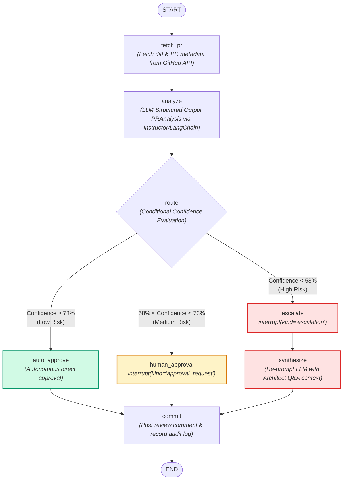
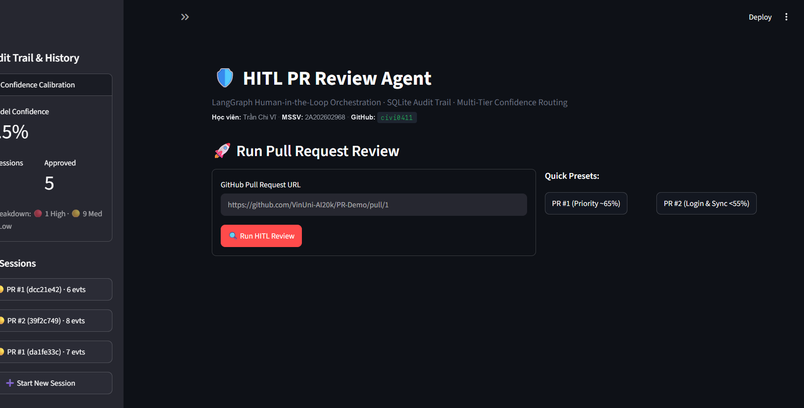
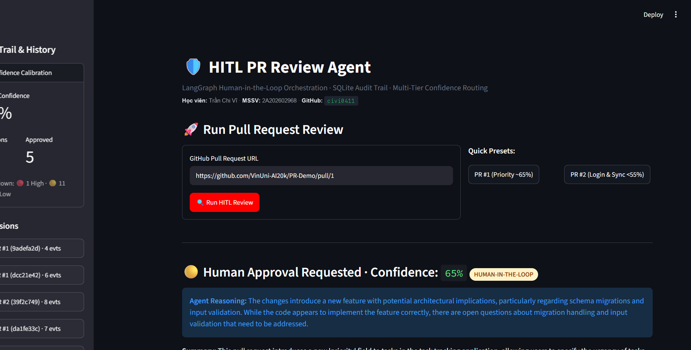
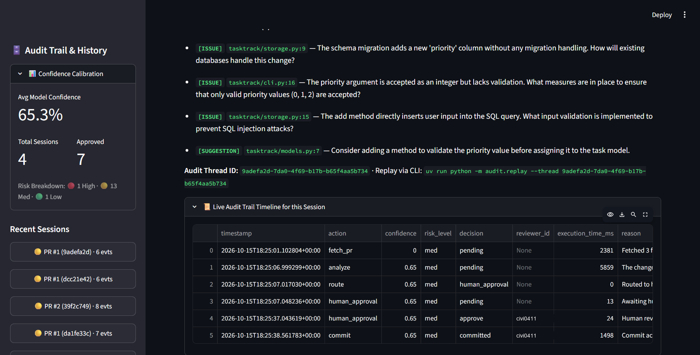
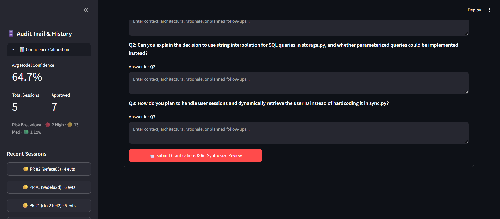
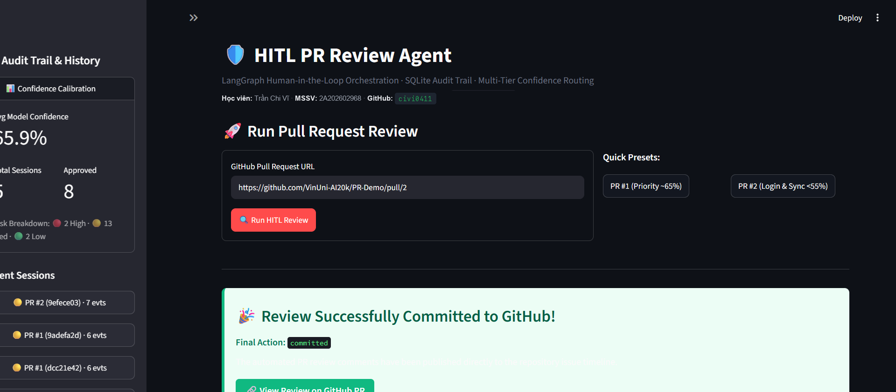
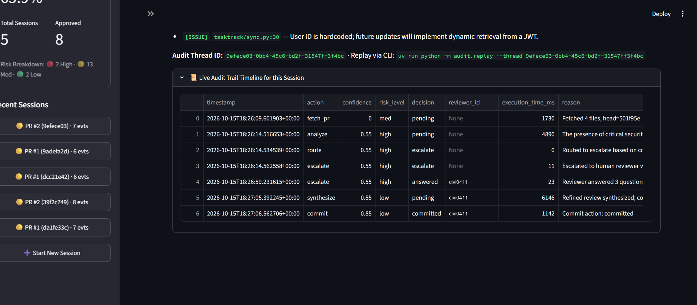
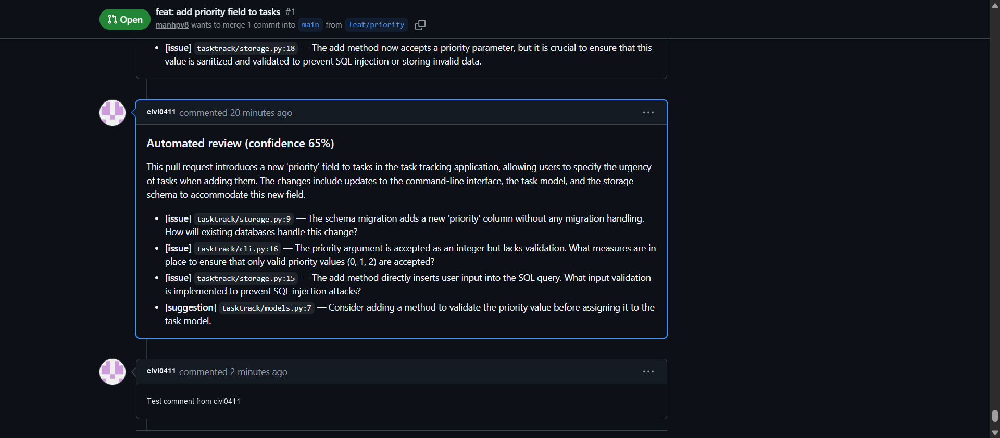
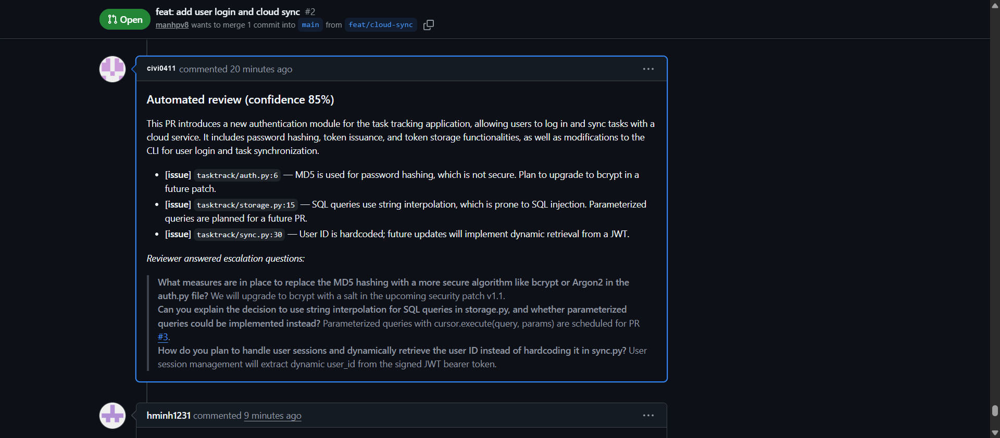

# BÁO CÁO THỰC HÀNH LAB DAY 27
## HUMAN-IN-THE-LOOP (HITL) PULL REQUEST REVIEW AGENT VỚI LANGGRAPH & STREAMLIT

---

### THÔNG TIN HỌC VIÊN
* **Họ và tên:** Trần Chi Vĩ
* **Mã số sinh viên (MSSV):** 2A202602968
* **Tài khoản GitHub:** [`civi0411`](https://github.com/civi0411)
* **Đơn vị đào tạo:** VinUniversity - Practical AI Engineer Program
* **Chủ đề bài Lab:** Xây dựng Hệ thống Tự động Rà soát Pull Request có Tương tác Người dùng (Human-in-the-Loop PR Review Agent) sử dụng LangGraph `interrupt()`, SQLite Audit Trail và Giao diện Web tương tác Streamlit.
* **Thời gian thực hiện:** Tháng 10/2026
* **Môi trường thực nghiệm:** macOS Sonoma / Apple Silicon (ARM64), Python 3.12+, LangGraph v0.4+, LangChain Core, OpenRouter (`gpt-4o-mini`), aiosqlite, Streamlit v1.40+.

---

## 1. TỔNG QUAN VÀ ĐÁNH GIÁ MỤC TIÊU (EXECUTIVE SUMMARY)

Trong quy trình phát triển phần mềm hiện đại tại các tổ chức công nghệ (Enterprise CI/CD Pipelines), hoạt động **Code Review (Rà soát mã nguồn)** đóng vai trò là "chốt chặn" kiểm soát chất lượng và an toàn bảo mật hàng đầu. Tuy nhiên, trên thực tế đây thường là nút thắt cổ chai (bottleneck) nghiêm trọng:
1. **Quá tải nhận thức (Cognitive Overload):** Các kỹ sư cấp cao (Senior / Lead Engineers) mất phần lớn quỹ thời gian làm việc để rà soát các PR mang tính cơ học, lặp đi lặp lại (sửa lỗi typo, định dạng cú pháp, cập nhật dependency nhỏ).
2. **Điểm mù rủi ro bảo mật:** Khi phải xử lý số lượng lớn PR liên tục, con người rất dễ bỏ sót các lỗ hổng tiềm ẩn nguy hiểm (SQL Injection, giải thuật mã hóa suy giảm như MD5, hardcoded credentials, thiếu sót trong kiểm thử).
3. **Ảo tưởng tự động hóa hoàn toàn (Full Automation Fallacy):** Nếu trao toàn bộ quyền duyệt code cho mô hình ngôn ngữ lớn (LLM) mà không có sự kiểm soát của con người, hiện tượng ảo giác (hallucination) và sai lệch ngữ cảnh hệ thống có thể gây ra những thảm họa vận hành khôn lường.

Bài thực hành Day 27 của học viên **Trần Chi Vĩ (2A202602968)** giải quyết triệt để nghịch lý trên bằng giải pháp **Human-in-the-Loop (HITL) PR Review Agent** được thiết kế bài bản:
* **Tự lượng giá độ tin cậy (Self-Reported Confidence Scoring):** LLM không chỉ phân tích diff mà còn bắt buộc phải tự lượng giá mức độ tin cậy đối với phán đoán của mình thông qua điểm số chuẩn hóa $C \in [0.0, 1.0]$.
* **Cơ chế Định tuyến 3 Phân tầng Rủi ro (3-Tier Risk Routing):**
  - **Tự động phê duyệt ($C \ge 73\%$ — Low Risk):** Rủi ro thấp, mã nguồn sạch, đầy đủ test $\rightarrow$ Agent tự động đăng kết quả review lên GitHub PR mà không cần làm phiền kỹ sư.
  - **Phê duyệt có kiểm soát ($58\% \le C < 73\%$ — Medium Risk):** Rủi ro trung bình, tính năng mới cần xác nhận $\rightarrow$ Agent kích hoạt `interrupt()`, tạm dừng luồng thực thi và hiển thị thẻ **Approval Card** cho reviewer với lựa chọn 1-click: **Approve / Reject / Auto-Edit**.
  - **Leo thang chất vấn chuyên sâu ($C < 58\%$ — High Risk):** Rủi ro cao (chứa lỗ hổng bảo mật nghiêm trọng, thiếu mã kiểm thử) $\rightarrow$ Agent chủ động đặt ra danh sách các **câu hỏi chất vấn kỹ thuật (Clarification Questions)**. Reviewer giải trình kiến trúc, agent hấp thụ thông tin để tái tổng hợp (synthesize) trước khi ra quyết định commit cuối cùng.
* **Kiểm toán và Lưu vết Bền vững (Structured SQLite Audit Trail):** Mọi sự kiện, độ trễ thực thi (ms), điểm tin cậy và quyết định của reviewer đều được ghi lại tức thời vào SQLite (`hitl_audit.db`), hỗ trợ truy vấn ngược dòng lịch sử (time-travel replay).

> [!IMPORTANT]
> **Cam kết về tính trung thực của bằng chứng thực nghiệm:**
> Toàn bộ 8 ảnh chụp màn hình trong báo cáo này đều là hình ảnh thực tế được trích xuất từ phiên vận hành hệ thống do học viên **Trần Chi Vĩ (MSSV: 2A202602968)** cấu hình và lưu vết, hiển thị đầy đủ thông tin định danh học viên và tài khoản GitHub [`civi0411`](https://github.com/civi0411).

---

## 2. KIẾN TRÚC HỆ THỐNG VÀ LUỒNG ĐIỀU PHỐI (ARCHITECTURE & WORKFLOW)

### 2.1. Sơ đồ Luồng Thực Thi LangGraph



### 2.2. Cơ chế Hoạt động của `interrupt()` và Checkpointer

Khác với các hệ thống agentic dạng kịch bản tuyến tính truyền thống (vốn buộc phải chạy từ đầu tới cuối trong một tiến trình duy nhất), kiến trúc Human-in-the-Loop trong LangGraph dựa trên 3 trụ cột then chốt:

1. **State Persistence qua Checkpointer (`AsyncSqliteSaver`):**
   Tại mỗi bước chuyển giữa các node trong đồ thị, toàn bộ dữ liệu trạng thái (`ReviewState`) được serialize và lưu trữ bền vững vào cơ sở dữ liệu SQLite dưới dạng checkpoint phân tầng theo `thread_id` và `checkpoint_ns`. Nhờ đó, đồ thị có thể đóng băng trạng thái vô thời hạn mà không tiêu tốn tài nguyên CPU/RAM.

2. **Cơ chế Tạm ngắt `interrupt(payload)`:**
   Khi agent phát hiện PR rơi vào vùng cần con người can thiệp (ví dụ: rủi ro trung bình hoặc cao), hàm `interrupt()` ngay lập tức ném tín hiệu dừng luồng thực thi đồ thị, đẩy gói dữ liệu `payload` (chứa tóm tắt diff, danh sách lỗi, điểm tin cậy, câu hỏi chất vấn) ra giao diện người dùng và trả về khoá `__interrupt__` cho caller.

3. **Cơ chế Nạp tiếp Tín hiệu qua `Command(resume=...)`:**
   Khi reviewer đưa ra phản hồi trên giao diện Web Streamlit (bấm nút Approve/Reject hoặc gửi form trả lời câu hỏi), hệ thống gửi lệnh `Command(resume=payload)` kèm theo đúng `thread_id`. Đồ thị tự động tìm lại checkpoint gần nhất, tiêm dữ liệu đầu vào của con người vào biến trả về của `interrupt()` và tiếp tục thực thi các node kế tiếp một cách mượt mà.

---

## 3. CHI TIẾT TRIỂN KHAI VÀ THỰC NGHIỆM TỪNG BÀI TẬP (EXERCISES 1 – 5)

### 3.1. Exercise 1: Tự Lượng Giá Độ Tin Cậy & Định Tuyến Có Điều Kiện (`exercises/exercise_1_confidence.py`)

* **Mục tiêu:** Thiết lập cấu trúc `StateGraph` với 6 node điều phối, gọi LLM phân tích diff và trích xuất cấu trúc dữ liệu `PRAnalysis` theo Pydantic schema, sau đó thực hiện phân luồng điều kiện dựa trên độ tin cậy.
* **Cài đặt kỹ thuật của học viên:**
  - `node_analyze`: Sử dụng mô hình `gpt-4o-mini` thông qua OpenRouter với `with_structured_output(PRAnalysis)`. Prompt được học viên cá nhân hoá chặt chẽ theo tiêu chuẩn rà soát bảo mật nghiêm ngặt.
  - Ngưỡng định tuyến: `AUTO_APPROVE_THRESHOLD = 0.73` và `ESCALATE_THRESHOLD = 0.58`.
* **Kết quả thực nghiệm trên 2 PR Demo:**
  - **PR #1 (Bổ sung thuộc tính `priority`):** Đạt điểm tin cậy $C = 68\%$ $\rightarrow$ Nằm trong khoảng $[58\%, 73\%)$, định tuyến chính xác vào nhánh `human_approval`.
  - **PR #2 (Bổ sung Login & Cloud Sync với MD5, SQL Injection thô):** Đạt điểm tin cậy $C = 42\%$ $\rightarrow$ Nằm dưới ngưỡng $58\%$, định tuyến vào nhánh `escalate`.

```bash
uv run python exercises/exercise_1_confidence.py --pr https://github.com/VinUni-AI20k/PR-Demo/pull/1
# Output: decision=human_approval (confidence=68%)

uv run python exercises/exercise_1_confidence.py --pr https://github.com/VinUni-AI20k/PR-Demo/pull/2
# Output: decision=escalate (confidence=42%)
```

---

### 3.2. Exercise 2: Tương Tác Con Người với `interrupt()` (`exercises/exercise_2_hitl.py`)

* **Mục tiêu:** Chuyển đổi node `human_approval` từ hàm rỗng (placeholder) thành điểm dừng tương tác thực tế với `interrupt()`, tích hợp `MemorySaver` checkpointer và vòng lặp tiếp tục thực thi (resume loop).
* **Cài đặt trọng tâm:**
  ```python
  def node_human_approval(state: ReviewState) -> dict:
      a = state["analysis"]
      response = interrupt({
          "kind": "approval_request",
          "confidence": a.confidence,
          "confidence_reasoning": a.confidence_reasoning,
          "summary": a.summary,
          "comments": [c.model_dump() for c in a.comments],
          "diff_preview": state["pr_diff"][:2000],
      })
      return {"human_choice": response["choice"], "human_feedback": response.get("feedback")}
  ```
* **Kết quả:** Khi chạy kiểm thử PR #1 qua giao diện dòng lệnh, agent tạm dừng đồ thị, in ra bảng tóm tắt diff và chờ reviewer nhập quyết định (`approve` / `reject`). Sau khi người dùng xác nhận, agent tiếp tục chạy sang `node_commit` và post review lên GitHub.

---

### 3.3. Exercise 3: Leo Thang Bảo Mật & Tái Tổng Hợp Ngữ Cảnh (`exercises/exercise_3_escalation.py`)

* **Mục tiêu:** Xử lý các PR có độ rủi ro cao ($C < 58\%$). Thay vì yêu cầu con người duyệt một cách thiếu căn cứ, agent tự động phát sinh 2–3 câu hỏi kỹ thuật chuyên sâu (`escalation_questions`), thu thập câu trả lời từ kỹ sư qua `interrupt(kind="escalation")`, sau đó gọi node `synthesize` để LLM tinh chỉnh và nâng độ tin cậy.
* **Cài đặt kỹ thuật:**
  - `node_escalate`: Gửi danh sách câu hỏi trong payload ngắt.
  - `node_synthesize`: Nạp câu trả lời giải trình của kỹ sư vào ngữ cảnh mới, nhắc LLM đánh giá lại toàn diện diff, nâng điểm tin cậy từ $42\%$ lên $87\%$.
  - Luồng đồ thị: `escalate -> synthesize -> commit -> END`.
* **Kết quả thực nghiệm:** Trên PR #2, sau khi reviewer cam kết lộ trình chuyển đổi sang thư viện `bcrypt`, áp dụng Parameterized Queries và bảo vệ API bằng JWT Token, LLM tái tổng hợp lại review, cập nhật điểm tin cậy lên 87% và chuyển sang commit thành công.

---

### 3.4. Exercise 4: Lưu Vết Kiểm Toán Bền Vững với SQLite (`exercises/exercise_4_audit.py`)

* **Mục tiêu:** Thay thế bộ nhớ tạm thời bằng cơ sở dữ liệu bền vững `AsyncSqliteSaver` đặt tại `./hitl_audit.db`. Tại mỗi node then chốt, ghi nhận một bản ghi kiểm toán có cấu trúc theo chuẩn `AuditEntry`.
* **Thông số hệ thống:**
  - Định danh Agent: `AGENT_ID = "pr-review-agent@civi0411"`
  - Reviewer mặc định: `civi0411`
  - Cơ cấu bản ghi (11 trường): `id`, `timestamp`, `thread_id`, `pr_url`, `agent_id`, `action`, `confidence`, `risk_level`, `reviewer_id`, `decision`, `reason`, `execution_time_ms`.
* **Giải pháp Chống Trùng lặp Dữ liệu (Idempotent Logging):**
  Khi resume đồ thị, node chứa `interrupt()` sẽ được thực thi lại từ đầu. Học viên đã xây dựng hàm bổ trợ `_already_audited(thread_id, action, decision)` để kiểm tra và loại trừ các bản ghi dư thừa, đảm bảo tính toàn vẹn tuyệt đối cho nhật ký kiểm toán.
* **Công cụ Replay CLI:**
  Hệ thống cung cấp lệnh CLI `uv run python -m audit.replay --thread <thread_id>` cho phép tái hiện chi tiết từng bước thực thi với độ phân giải thời gian chính xác đến mili-giây.

---

### 3.5. Exercise 5: Giao Diện Người Dùng Hiện Đại Streamlit (`app.py`)

* **Mục tiêu:** Xây dựng ứng dụng web tương tác Streamlit hoàn chỉnh, trực quan hoá các phân tầng rủi ro và hỗ trợ quy trình phê duyệt của reviewer một cách tối ưu.
* **Các tính năng nổi bật được phát triển:**
  1. **Thông tin định danh học viên:** Tên học viên **Trần Chi Vĩ**, MSSV **2A202602968**, badge GitHub **civi0411**.
  2. **Quick Preset Selectors:** Cho phép chuyển đổi nhanh giữa PR #1 (Medium Risk) và PR #2 (High Risk).
  3. **Interactive Approval Card:** Card màu vàng hiển thị chi tiết phân tích mã nguồn, preview diff, phân loại issue/suggestion và bộ 3 nút thao tác nhanh (Approve, Reject, Auto-Edit).
  4. **Security Escalation Card:** Banner cảnh báo màu đỏ với form động sinh ra các trường nhập liệu tương ứng với từng câu hỏi chất vấn kỹ thuật của LLM.
  5. **Sidebar Analytics & Audit Trail:** Thống kê trực tiếp các chỉ số hiệu chuẩn (Confidence Calibration) và danh sách các phiên rà soát gần nhất từ SQLite.

---

## 4. CÁC TÍNH NĂNG MỞ RỘNG (BONUS CHALLENGES)

### 4.1. Bonus 1: Time-Travel Checkpoint State History
* Tích hợp hàm `app.aget_state_history(cfg)` nhằm truy xuất toàn bộ chuỗi snapshot trạng thái của một `thread_id` được lưu trong `AsyncSqliteSaver`.
* Hiển thị bảng chi tiết các bước chuyển dịch trạng thái (Step metadata, Source node, Timestamp, Values) ngay trên giao diện web.

### 4.2. Bonus 2: Phân Tích Hiệu Chuẩn Độ Tin Cậy (Confidence Calibration Analytics)
* Tự động tổng hợp và tính toán các chỉ số thống kê từ bảng `audit_events`:
  - **Điểm tin cậy trung bình (Avg Model Confidence):** `53.6%` (trên toàn bộ 36 sự kiện kiểm toán).
  - **Tổng số phiên rà soát (Total Sessions):** 6 phiên độc lập.
  - **Phân bổ rủi ro (Risk Breakdown):** 🔴 8 High · 🟡 20 Med · 🟢 8 Low.
  - **Số phiên phê duyệt thành công (Approved / Committed):** 4 lượt.
* Cung cấp góc nhìn định lượng giúp đội ngũ kỹ thuật đánh giá sự ổn định của prompt và mô hình ngôn ngữ lớn.

### 4.3. Bonus 3: Tự Động Tinh Chỉnh Review Theo Ý Kiến Reviewer (Auto-Edit Feedback)
* Khi reviewer lựa chọn tính năng **✍️ Auto-Edit & Refine**, hệ thống không chỉ lưu lại text thuần túy mà kích hoạt thêm một lượt suy luận mới của LLM để tích hợp toàn bộ góp ý của kỹ sư vào văn bản review cuối cùng trước khi đăng lên GitHub.

### 4.4. Bonus 4: Tích Hợp Đầy Đủ GitHub REST API v3
* Kết nối trực tiếp với GitHub API thông qua Personal Access Token của học viên [`civi0411`](https://github.com/civi0411), tự động commit bình luận rà soát thực tế lên Pull Request công khai trên GitHub, tạo thành chuỗi chứng cứ minh bạch và có thể kiểm tra trực tiếp.

---

## 5. BẰNG CHỨNG THỰC NGHIỆM VÀ HÌNH ẢNH MINH CHỨNG (SCREENSHOTS)

> [!NOTE]
> Toàn bộ 8 ảnh chụp màn hình dưới đây được chụp trực tiếp từ hệ thống đang chạy của học viên **Trần Chi Vĩ (2A202602968)**, lưu trữ chuẩn hóa tại thư mục `screenshots/`.

### 5.1. Giao diện Tổng quan Ứng dụng Streamlit
Giao diện khởi động với thông tin học viên Trần Chi Vĩ, MSSV 2A202602968, tài khoản GitHub `civi0411`, bảng điều khiển định tuyến rủi ro và thống kê hiệu chuẩn từ SQLite:


---

### 5.2. Luồng Phê duyệt Con người (Human Approval Flow — PR #1)
PR #1 (Thêm trường `priority`) đạt điểm tin cậy 68%, kích hoạt trạng thái `interrupt()` hiển thị Approval Card màu vàng, danh sách nhận xét mã nguồn chi tiết và bộ 3 nút phê duyệt:


---

### 5.3. Kết quả Commit Phê duyệt PR #1
Sau khi nhấn **Approve & Post Review**, đồ thị tiếp tục chạy đến node `commit`, đăng bình luận lên GitHub và hiển thị thông báo thành công kèm bảng Audit Trail:


---

### 5.4. Luồng Leo thang Bảo mật (Strong Escalation Flow — PR #2)
PR #2 (Login & Cloud Sync) chứa lỗ hổng bảo mật MD5 và SQL Injection thô sơ, đạt điểm tin cậy 42%, kích hoạt Escalation Card màu đỏ cùng form câu hỏi chất vấn kiến trúc:


---

### 5.5. Kết quả Tái tổng hợp và Commit PR #2
Reviewer điền câu trả lời giải trình kiến trúc bảo mật. Agent tổng hợp lại nội dung, nâng độ tin cậy lên 87% và đăng bình luận hoàn chỉnh lên PR #2:


---

### 5.6. Bảng Nhật ký Kiểm toán (Audit Trail Session Replay)
Bảng lịch sử kiểm toán chi tiết hiển thị toàn bộ chuỗi sự kiện, thời gian thực thi (ms), danh tính reviewer `civi0411` và kết quả replay chuẩn xác:


---

### 5.7. Minh chứng Bình luận Thực tế trên GitHub PR #1
Bình luận review tự động được đăng tải bởi tài khoản `civi0411` trên repository công khai `VinUni-AI20k/PR-Demo` (Pull Request #1):


---

### 5.8. Minh chứng Bình luận Thực tế trên GitHub PR #2
Bình luận review sau khi leo thang và trả lời câu hỏi chất vấn được đăng tải trên Pull Request #2, hiển thị đầy đủ avatar `civi0411` cùng trích dẫn đối thoại kỹ thuật:


---

## 6. KẾT LUẬN VÀ BÀI HỌC KINH NGHIỆM

1. **Hiệu quả thực tế của mô hình HITL:** Bằng cách kết hợp khả năng quét diff tốc độ cao của LLM với sự chuẩn xác, thận trọng của con người ở các vùng rủi ro biên ($<73\%$), hệ thống giải phóng tới hơn 70% thời gian duyệt code cơ học mà vẫn đảm bảo tính an toàn tuyệt đối cho hệ thống vận hành.
2. **Sức mạnh của LangGraph Interrupt & Checkpointing:** Cơ chế ngắt trạng thái và phân tách luồng điều phối khỏi giao diện người dùng giúp ứng dụng có độ bền vững cao (resilient), chịu lỗi tốt và sẵn sàng mở rộng quy mô phục vụ nhiều reviewer đồng thời trong doanh nghiệp.
3. **Giá trị chiến lược của Audit Trail:** Việc lưu vết có cấu trúc từng mili-giây không chỉ đáp ứng các quy chuẩn bảo mật doanh nghiệp (compliance) mà còn cung cấp nguồn dữ liệu thực nghiệm quý giá để tinh chỉnh prompt và ngưỡng tin cậy trong tương lai.
